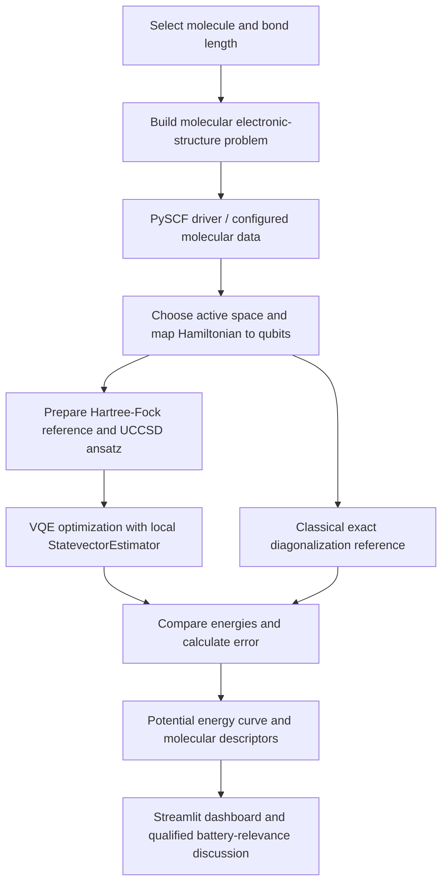

<div align="center">

# Anonymous

**Team ID:** `VTU-QFF-HC-0023` &nbsp;|&nbsp; **Tier:** Both

</div>

---

| Hackathon Detail | Information |
| :--- | :--- |
| **Team Name** | Anonymous |
| **Team ID** | `VTU-QFF-HC-0023` |
| **Tier** | Both |
| **Repository** | [vtu-hc-anonymous](https://github.com/vtu-qiskit-fall-fest-2026/vtu-hc-anonymous) |
| **Organisation** | [vtu-qiskit-fall-fest-2026](https://github.com/vtu-qiskit-fall-fest-2026) |
| **Event** | VTU-Qiskit Fall Fest 2026 |

---

## 📌 Table of Contents

- [Team Members](#-team-members-github-ids)
- [Problem Statement](#-problem-statement)
- [Proposed Solution](#-proposed-solution)
- [Approach and Architecture](#-approach-and-architecture)
- [Tech Stack](#-tech-stack)
- [Project Structure](#-project-structure)
- [Molecules and Scope](#-molecules-and-scope)
- [Metrics and Scientific Interpretation](#-metrics-and-scientific-interpretation)
- [Benchmarking and Accuracy](#-benchmarking-and-accuracy)
- [Battery-Relevance Assessment](#-battery-relevance-assessment)
- [How to Run](#-how-to-run)
- [How to Run in Google Colab](#-how-to-run-in-google-colab)
- [Tests](#-tests)
- [How to Push Code](#-how-to-push-code)
- [Submission Checklist](#-submission-checklist)
- [Resources](#-resources)
- [Limitations and Future Work](#-limitations-and-future-work)
- [License](#-license)

---

## 👥 Team Members (GitHub IDs)

| # | Name | GitHub Username | Role |
| :-- | :--- | :--- | :--- |
| 1 | Nandita Salunke | [@nandita-salunke](https://github.com/nandita-salunke) | Team Lead |
| 2 | Ramling Belkeri | [@ramling-2008](https://github.com/ramling-2008) | Team Member / Developer |

> Confirm both members have accepted their repository collaborator invitations before submission.

## ❓ Problem Statement

**Problem:** Battery research involves understanding the chemical species that can form at electrode–electrolyte interfaces and how their molecular properties relate to possible roles in battery materials. Experimental investigation and detailed materials modelling can be resource-intensive. Small-molecule quantum-chemistry calculations can help explore selected chemical interactions, but molecular calculations alone do not capture the behaviour of a complete battery material.

**Why it matters:** An interactive tool can show how molecular energy changes with bond distance, compare VQE with a classical reference, and explain what more must be known before making claims about battery performance.

**Track / Category:** Quantum Chemistry and Sensing.

**Hackathon tier:** Both.

---

## 💡 Proposed Solution

**Solution:** Q-Lithos is an interactive Streamlit dashboard for exploring small molecules. It uses Qiskit's Variational Quantum Eigensolver (VQE), compares its energies with a classical calculation, plots the results, and explains what they may—and may not—tell us about battery research.

**Key idea:** Compare a quantum-algorithm calculation with a classical reference for the same small molecular model, then explain the results in plain language.

**Why this approach:** The comparison shows how closely VQE matches the reference for the model being tested. The dashboard also makes clear that molecular results are not the same as real battery properties.

**Current status:** A working dashboard prototype has been launched in Google Colab. Execution on physical IBM Quantum hardware has not been established by the project information available for this README.

---

## 🖥️ Demo Screenshots

The screenshots below show the current Streamlit prototype. The simulation uses a local ideal statevector simulator; they are not evidence of execution on physical IBM Quantum hardware. Displayed numerical values should be treated as prototype outputs until the saved benchmark data and metric calculations have been validated.

### Dashboard overview


### LiH quantum simulation


## 🧩 Approach and Architecture



1. **Input:** A supported diatomic molecule and a selected or scanned bond distance.
2. **Preprocessing:** Construct the electronic-structure problem, define the active space, and generate the molecular Hamiltonian using the configured chemistry workflow.
3. **Quantum algorithm:** Use a Hartree–Fock reference state and a UCCSD variational ansatz in a VQE optimization loop.
4. **Reference and post-processing:** Compare VQE energies with classical exact diagonalization for the same model and geometry. Calculate only those molecular descriptors supported by the implemented calculations.
5. **Output:** Interactive potential energy curves, error summaries, descriptor views, and a battery-relevance assessment that identifies missing evidence.

### Important implementation note

The documented workflow uses Qiskit's `StatevectorEstimator`, which is a **local ideal statevector simulator**. It is not evidence of execution on a physical IBM Quantum processor. The actual execution path can also depend on the installed dependencies and platform-specific code paths; consult the code and run logs for the environment being used.

---

## 🛠️ Tech Stack

| Layer | Technology |
| :--- | :--- |
| Language | Python |
| Quantum SDK | Qiskit |
| Quantum chemistry | Qiskit Nature, PySCF where supported |
| Variational algorithm | VQE with a UCCSD ansatz |
| Classical optimization | SLSQP (as configured in the documented workflow) |
| Local simulation | Qiskit `StatevectorEstimator` |
| Dashboard | Streamlit |
| Numerical analysis | NumPy and pandas; plotting libraries as listed in `requirements.txt` |
| Testing | pytest |
| Version control | Git and GitHub |

For exact compatible versions, use the repository's `requirements.txt` rather than assuming that every version of these packages is interchangeable.

---

## 📁 Project Structure

The main application files described by the project include:

```text
anonymous/
├── app.py                 # Streamlit dashboard
├── vqe_engine.py          # VQE / quantum chemistry workflow
├── molecules.py           # Molecule definitions and geometry settings
├── metrics.py             # Derived molecular metrics
├── scan.py                # Bond-length scan workflow
├── requirements.txt       # Python dependencies
├── pytest.ini             # pytest configuration
├── tests/                 # Automated tests
└── cache/                 # Cached scan results
```

The dashboard's battery-relevance discussion is implemented in the application; this ZIP does not contain a separate `battery_assessment.py` module. Cached scan results are included, so validate or regenerate them after changing metric definitions.

---

## 🧪 Molecules and Scope

The project identifies these four diatomic systems:

| Molecule | Formula | Intended context in this prototype |
| :--- | :---: | :--- |
| Lithium hydride | LiH | Battery-relevant molecular species for exploratory comparison |
| Sodium hydride | NaH | Sodium-related interfacial/decomposition chemistry context |
| Sodium fluoride | NaF | Fluoride-containing interphase chemistry context |
| Dilithium | Li₂ | Homonuclear molecular benchmark; not a battery-material performance model |

The calculations are for **isolated diatomic molecules**, not periodic solids, full electrode–electrolyte interfaces, or complete battery cells. The active-space and qubit counts depend on the implemented model and should be checked against the current code and configuration.

---

## 📐 Metrics and What They Mean

- **Potential energy curve:** How the calculated molecular energy changes as the bond distance changes.
- **Equilibrium bond length:** The bond distance near the lowest point on that curve.
- **Dissociation-energy estimate:** The energy needed to separate the atoms, only when the separated-atom reference is calculated correctly. This is not a battery voltage or an electronic energy gap.
- **Force-constant estimate:** How steep the energy curve is near the bond minimum. It describes the isolated molecule, not the stiffness of a bulk material.
- **VQE error:** The difference between the VQE energy and the classical reference energy for the same model and bond distance.

**Important:** If the code has not calculated an electronic energy gap, the dashboard must show it as unavailable. A dissociation or binding energy must never be relabelled as an energy gap. Cached results should be checked after changes to metric definitions.

---

## 📊 Benchmarking and Accuracy

Q-Lithos compares the energy found by VQE with a classical exact-diagonalization result for the same small model and bond distance. This checks how closely the VQE calculation matches that reference; it does **not** prove that the model perfectly describes a real molecule or battery.

**Chemical accuracy** is a commonly used target of about **1.6 mHa** (1 kcal/mol). To say a whole scan meets this target, every tested bond distance must have an absolute VQE error below the threshold. A low average error alone is not enough.

The project ZIP contains saved scan results, but they may have been created before recent metric fixes. Therefore, the values below are not presented as newly verified benchmark results. The saved Li₂ scan includes an error of about **4.02 mHa** at a stretched bond distance, which is above the chemical-accuracy target. The other saved results also need to be checked before final numbers are quoted.

| Molecule | What can be said responsibly right now? |
| :--- | :--- |
| LiH | Saved scan data exists; final accuracy claim needs cache validation. |
| NaH | Saved scan data exists; final accuracy claim needs cache validation. |
| NaF | Saved scan data exists; final accuracy claim needs cache validation. |
| Li₂ | Saved scan includes an error above the chemical-accuracy target at a stretched bond distance. |

Do not describe all molecules as meeting chemical accuracy unless the current code, saved data, and test results support that claim.

---

## 🔋 Battery-Relevance Assessment

Q-Lithos connects small-molecule calculations to battery research questions, but it does **not** predict battery performance directly. Its results can help explain molecular bonding and identify questions for future study.

An isolated molecule calculation cannot, by itself, determine:

- How quickly lithium or sodium ions move through a solid
- Ionic conductivity or diffusion barriers
- Battery voltage or electrochemical stability
- Capacity, energy density, or cycle life
- Bulk thermal stability, mechanical strength, or dendrite suppression

For these properties, researchers need additional calculations on realistic materials, trusted published data, or experiments. Any dashboard rating should explain the evidence, missing information, and uncertainty. A strong molecular bond alone is not proof that a material will make a better battery.

---

## 🚀 How to Run

### Prerequisites

- Python version compatible with `requirements.txt` (the detailed project README lists Python 3.10–3.12).
- Git, if cloning the repository.
- A supported environment for the chemistry dependencies. PySCF installation/support can differ by operating system.

### 1. Clone the repository

```bash
git clone https://github.com/vtu-qiskit-fall-fest-2026/vtu-hc-anonymous.git
cd vtu-hc-anonymous
```

### 2. Create and activate a virtual environment

**Windows PowerShell:**

```powershell
python -m venv .venv
.\.venv\Scripts\Activate.ps1
```

**Linux / macOS:**

```bash
python3 -m venv .venv
source .venv/bin/activate
```

### 3. Install dependencies

```bash
python -m pip install --upgrade pip
pip install -r requirements.txt
```

If installation fails, use the error output and the package versions in `requirements.txt` to diagnose the environment. Do not assume that installing only `qiskit` is sufficient for the chemistry workflow.

### 4. Run tests

```bash
python -m pytest tests/ -v
```

Review the actual test output. Do not describe the suite as passing unless the command completes successfully in the environment being reported.

### 5. Launch the dashboard

```bash
streamlit run app.py
```

Open the local URL printed by Streamlit, usually `http://localhost:8501`.

---

## ☁️ How to Run in Google Colab

1. Upload the project ZIP to Colab and extract it.
2. Change into the extracted directory containing `app.py`.
3. Install the project dependencies. Prefer the repository's `requirements.txt` when compatible with the Colab Python runtime:

```python
%pip install -r requirements.txt
```

If the repository dependencies cannot be installed as written, inspect the error and resolve the version/platform issue rather than silently substituting different versions.

4. Run the tests:

```python
!python -m pytest tests/ -v
```

5. Start Streamlit in the background:

```python
!streamlit run app.py --server.port 8501 --server.address 0.0.0.0 --server.enableCORS false --server.enableXsrfProtection false --server.headless true > /content/streamlit.log 2>&1 &
```

6. In a new cell, obtain the Colab proxy URL:

```python
from google.colab import output
url = output.eval_js("google.colab.kernel.proxyPort(8501)")
print(url)
```

Open the URL printed by Colab. Keep the runtime running while using the dashboard. Dependency availability and compatibility may vary with the current Colab runtime.

---

## 🧪 Tests

The repository includes a `tests/` directory. Run:

```bash
python -m pytest tests/ -v
```

The test result should be reported from the current checkout and environment. Tests can check software behaviour and metric definitions, but passing tests alone do not establish that a model predicts real-world battery performance.

Recommended validation before release:

- Confirm every cached result matches the current metric definitions; regenerate stale cache files.
- Confirm that energy-gap fields are only populated when an actual gap calculation exists.
- Test the units and definitions used for dissociation-energy and force-constant calculations.
- Compare VQE and reference energies at the same geometry and with the same Hamiltonian.
- Report maximum as well as mean absolute error across each scan.
- Check that the dashboard does not present local simulation as physical quantum-hardware execution.

---

## 🔁 How to Push Code

Configure Git once:

```bash
git config --global user.name "Your Name"
git config --global user.email "you@example.com"
```

A typical branch workflow is:

```bash
git checkout main
git pull origin main
git checkout -b docs/merge-project-readme
git status
git diff
git add README.md
git commit -m "docs: merge project and hackathon README"
git push -u origin docs/merge-project-readme
```

Open a pull request on GitHub and review the changes before merging. Follow the hackathon organizers' repository workflow if it differs from these steps.

Common commit prefixes:

| Prefix | Meaning |
| :--- | :--- |
| `feat:` | New feature |
| `fix:` | Bug fix |
| `docs:` | Documentation |
| `test:` | Test changes |
| `refactor:` | Code restructure |
| `chore:` | Maintenance or dependency changes |

---

## ✅ Submission Checklist

- [ ] Repository is public, if required by the event.
- [ ] Both team members are listed and have accepted collaborator invitations.
- [ ] README includes the problem, solution, architecture, team, and run instructions.
- [ ] `requirements.txt` is committed and installation from a clean environment has been tested.
- [ ] Tests have been run; any failures are documented or resolved.
- [ ] Cached data and scientific metric definitions have been reviewed after code changes.
- [ ] Add a genuine dashboard screenshot or demo-video link.
- [ ] Confirm the repository's actual license file matches the stated license.
- [ ] Submit the required project summary through the hackathon portal.

---

## 📚 Resources

| Resource | Link |
| :--- | :--- |
| Hackathon repository | [vtu-hc-anonymous](https://github.com/vtu-qiskit-fall-fest-2026/vtu-hc-anonymous) |
| Qiskit documentation | [IBM Quantum Documentation](https://docs.quantum.ibm.com/) |
| Qiskit Runtime | [IBM Quantum Platform Documentation](https://quantum.cloud.ibm.com/docs/) |
| Qiskit Nature | [Qiskit Nature documentation](https://qiskit-community.github.io/qiskit-nature/) |
| Streamlit | [Streamlit documentation](https://docs.streamlit.io/) |
| PySCF | [PySCF documentation](https://pyscf.org/) |
| GitHub | [GitHub Docs](https://docs.github.com/) |

---

## ⚠️ Limitations and Future Work

1. **Minimal basis set:** STO-3G is a small basis that limits quantitative accuracy and omits polarization and diffuse flexibility found in larger basis sets.
2. **Active-space approximation:** Restricting the active space reduces computational cost but omits electronic correlation outside that space.
3. **Isolated molecule model:** Diatomic gas-phase calculations do not represent periodic solids, realistic interfaces, solvent effects, defects, or full-cell operating conditions.
4. **Ideal simulator:** A local statevector simulation does not include real-device noise and does not demonstrate execution on a physical quantum processing unit.
5. **Battery properties require separate evidence:** Conductivity, diffusion, electrochemical voltage, capacity, cycling, thermal behaviour, and mechanical response need appropriate calculations, experimental data, or validated literature sources.
6. **Cached data and reproducibility:** Cached values can become stale when code or metric definitions change. Results should be regenerated and checked before being reported as current.

Future work may include validated higher-level electronic-structure calculations, explicit solid/interface models, well-sourced experimental and literature data, uncertainty reporting, and hardware execution only when an actual QPU run is configured and documented.

---

## 📄 License

This project is described as MIT-licensed in the existing project README. Confirm that a `LICENSE` file containing the MIT License is present in the repository before retaining this claim.

---

<div align="center">

**Anonymous** · Team ID `VTU-QFF-HC-0023` · Tier `Both`

Built with ⚛️ Qiskit for the VTU-Qiskit Fall Fest 2026 Hackathon.

[⬆ Back to Top](#anonymous)

</div>
